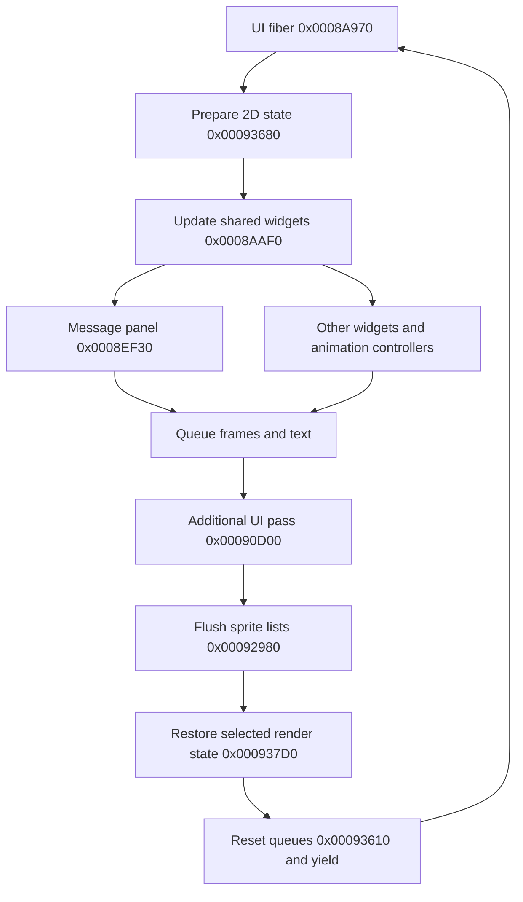

# Game UI construction and soundtrack notifications

Research date: 2026-09-29. Static analysis, not a gameplay acceptance result.

## Verdict

The game can draw a text panel outside the main menus. A small wrapper at
`0x00035070` accepts a guest text pointer in `EAX`; the more general message
entry at `0x0008F6C0` accepts a descriptor in `EAX`. Both operate on the game's
single shared message panel. They are **not safe, independent toast APIs**.
They replace message state, retain a text pointer, participate in dialog
animation and audio adjustment, and depend on the UI fiber running.

For an unobtrusive now-playing notification with arbitrary Unicode titles,
prefer a host D3D11 overlay with DirectWrite text and independently drawn
framing styled after the game. Publish a song-change event from the soundtrack
adapter; consume it at presentation. Do not call guest UI or D3D11 drawing
directly from the soundtrack-start wrapper.

A game-drawn alternative is feasible with restricted text: enqueue a frame
and text through the existing sprite renderer during its UI pass, using a
separate notification timer and guest-owned text storage. That avoids taking
over the dialog singleton, but still needs explicit resource, encoding,
queue-capacity, ordering, and scene-lifetime checks. This alternative has not
been implemented or run.

## Evidence and limits

The inspected XBE has SHA-256
`053d44e885fa33c1d15d909a533f39dfbd976e97eeaf67e4fdef8438ea7e5c54`,
image base `0x00010000`, and Ghidra language `x86:LE:32:default`.
Addresses below apply only to that verified disc revision. Findings combine
serial, bounded Ghidra decompilation/xref queries with the local generated C
used for custom-soundtrack work. Raw decompilation, strings, glyph tables,
asset locators, and inspection scripts remain under ignored `private/`.
This note contains analysis, not extracted strings, asset names, or code.

Names below are descriptive research names, not recovered source symbols.
Offsets and control flow are observed; interpretations and unconfirmed
behavior are called out. Ghidra leaves several valid code regions undefined,
and its inferred prototypes omit register arguments. Generated code resolves
those gaps; a zero Ghidra function count is not proof of dead code. Generated
fragments are also not necessarily independent original functions.

The running game was not stopped, rebuilt, or instrumented. No new runtime
run or xemu session was needed for this decision. Visibility during every
activity, movie, loading screen, and transition remains unconfirmed.

## Three layers of state

The scene loop starts at `0x000A37F0`; `0x000A3820` is an internal loop label.
It uses the current scene byte at `0x005DECE0`, requested scene byte at
`0x005DED55`, and a table at `0x002F5ED0` with 12-byte records containing
initialize, update, and exit function pointers. A scene change calls the old
exit and new initialize handlers before updating the current-scene byte.

Menus have another, global dispatcher at `0x009D9D80`. Initialization selects
a screen table and callback: `0x000CC600` installs 18 records at `0x002A8148`;
`0x000F3260` installs 12 records at `0x002A78B0` on its initial-entry path.
`0x000F26B0` resets the controller and calls the selected screen's entry hook.
`0x000F27C0` invokes the current screen's update hook and handles transitions.
These are plain function-pointer tables, not C++ vtables.

Separately, initialization at `0x000A3950` registers `0x0008A970` as a UI
fiber entry. With the enable byte at `0x005C5428` set, its loop does:



The enable-false path still clears the sprite queues. A notification queued
at an arbitrary audio callback could therefore be cleared, miss the current
flush, or run against the wrong render state. The shared UI fiber exists
independently of the menu dispatcher; this does not establish visibility in
every scene.

### Menu controller layout

Base `0x009D9D80`; this is a partial layout, with at least `0x8C` bytes used.

| Offset | Shape and meaning |
| --- | --- |
| `+0x00`, `+0x01`, `+0x02` | Signed bytes: current, previous, requested screen; negative means absent. |
| `+0x03` | Ten-byte screen history. |
| `+0x10` | History depth. |
| `+0x14` | Number of history entries to pop. |
| `+0x18` | Transition mode, logged as `phase`; initially `-1`. |
| `+0x1C` | Event/result delivered to the owner; initially `-1`. |
| `+0x20` | State: 0 entry delay, 1 settled, 2 forward transition, 3 return transition. |
| `+0x28`, `+0x2C` | Tick counter and transition threshold; default threshold 30. |
| `+0x30`, `+0x34` | Screen-table pointer and owner event callback. |
| `+0x38` | Completion gates: bit 0 callbacks, bit 1 timer. |
| `+0x3C`, `+0x4C` | Four completion function pointers and four corresponding arguments. |
| `+0x5C`, `+0x60` | Four **byte** completion flags, then callback count. |
| `+0x64`, `+0x68` | Additional transition hook tables; records are screen byte plus callback at `+4`, stride 8. |
| `+0x6C` | Screen-table record count. |
| `+0x70`, `+0x74` | Counts for the two additional hook tables. |
| `+0x88` | Optional pointer receiving the current-screen byte. |

The runtime's `recomp menu` line reads `state`, `screen`, owner `callback`,
screen `table`, and `entries`. **`entries` is the count at `+0x74`, not the
number of screens or visible menu items.** The screen count is at `+0x6C`.
Some diagnostic comments treat the completion flags as words; the initializer
and `0x000F2750` show byte flags and a capacity of four callbacks.

Each screen record is `0x20` bytes:

| Offset | Callback role |
| --- | --- |
| `+0x00` | Enter screen. |
| `+0x04` | Update current screen; called before transition processing. |
| `+0x08`, `+0x0C` | Begin and finish return/pop transition. |
| `+0x10` | Cancel a forward transition. |
| `+0x14`, `+0x18` | Begin and finish forward transition. |
| `+0x1C` | Opaque context passed with the controller pointer. |

`0x000F2C10` requests a forward transition; `0x000F2B50` requests a pop;
`0x000F2AD0` cancels a forward transition. `0x000F2750` requires every enabled
completion callback to finish and the enabled timer to expire. Opening a
screen is consequently a navigation operation, unsuitable for a toast.

## The gift-origin panel

The user-identified gift-origin box is constructed by `0x000E3A40`. Its
two direct callers are `0x000E1380`, the item interaction update, and
`0x000E21F0`, its state-transition handler. The transition handler invokes it
when entering state 4; the update invokes it after a selected-item change.
It checks item/sender identity, formats localized content into a shared
scratch buffer at `0x005C60D8`, and sets up the descriptor at `0x00EC9434`.
It then calls `0x0008F6C0` and clears the reveal flag at `0x005C5FA6`.

```text
item update / state transition
  -> 0x000E3A40: prepare shared text and message descriptor
  -> 0x0008F6C0: replace shared message state
  -> later UI-fiber tick: 0x0008EF30
       -> 0x0008AF90: panel lifecycle callbacks
            -> 0x0008FD90: frame animation and frame enqueue
       -> 0x00093A80: text parsing and glyph enqueue
  -> 0x00092980: bind resources and submit D3D8 quads
```

`0x0008F6C0` returns 0 when passed null with no queued message, otherwise 1
on its accepted paths. Acceptance does not mean that anything was drawn.
It copies the descriptor's fields but retains the text pointer. It resets
page/reveal counters, changes the message state, and calls `0x000E08E0`, which
reaches the volume-envelope updater `0x000B81D0`. `0x0008FF10`, the exit hook,
also resets that envelope. Thus even a visually passive use has audio-related
side effects; their audible effect during custom playback is unconfirmed.

`0x00035070` is the closest small convenience wrapper: text pointer in `EAX`,
no stack arguments. It sets a no-associated-audio value and an absent-speaker
marker, calls `0x0008F6C0`, then disables gradual reveal. `0x0008F6A0` accepts
text in `EAX` and the speaker marker in `CL`; it does not disable reveal.
Neither creates a separate panel or chooses an independent lifetime.

### Message and panel shapes

The transient message descriptor, passed to `0x0008F6C0` in `EAX`, is 12 bytes:

| Offset | Meaning |
| --- | --- |
| `+0x00` | Pointer to a null-terminated guest byte string. |
| `+0x04` | Associated audio/message identifier; `-1` on text-only paths. |
| `+0x08` | Speaker/portrait byte; `0xFE` means absent in these callers. |
| `+0x09` to `+0x0B` | Padding/unused by this entry. |

The message singleton begins at `0x005C5BA0`. The following is a partial
layout, not a replacement struct or a proven allocation boundary:

| Relative offset | Observed use |
| --- | --- |
| `+0x000` | Message state; separate from frame-animation state. |
| `+0x004` | Four line buffers, stride `0x100`. |
| `+0x404` | Displayed line count, byte. |
| `+0x405`, `+0x406` | Layout mode and gradual-reveal flag, bytes. |
| `+0x408`, `+0x40C` | Reveal interval and message tick counter. |
| `+0x410`, `+0x412` | Base x/y, 16-bit; reset defaults 56 and 350. |
| `+0x414`, `+0x416` | Normal and alternate widths, 16-bit; defaults 608 and 508. |
| `+0x418`, `+0x41A` | Height and text y offset, 16-bit; defaults 44 and 25. |
| `+0x41E` | Right edge; reset default 664. |
| `+0x420`, `+0x422`, `+0x424` | Animated left, y, and width. Left is recomputed as right minus width. |
| `+0x42A` to `+0x42D` | Layer, opacity, line spacing, language; default layer 3 and spacing 20. |
| `+0x42F`, `+0x430`, `+0x431` | Message/page control bytes; `+0x431` is queued-record count. |
| `+0x434` | Frame-style index, initially 0. |
| `+0x438`, `+0x43C` | Pause counter and saved parser cursor. |
| `+0x450` | Message records, stride 12, ten slots initialized. |
| `+0x4C8`, `+0x4CC` | Current source cursor and destination line-buffer pointer. |
| `+0x4D8` | Embedded animation controller; absolute `0x005C6078`. |
| `+0x4E8` | Callback group; absolute `0x005C6088`. |
| `+0x4F8`, `+0x4F9` | Current/previous speaker markers. |
| `+0x4FC`, `+0x500` | Speaker-change animation duration and tick. |
| `+0x504` | Speaker/portrait-related scale. |
| `+0x508`, `+0x50C` | Width-transition tick and duration. |
| `+0x510`, `+0x512` | Width interpolation endpoints. |
| `+0x514` | Text progress counter. |

`0x0008ED20` resets this singleton. `0x0008FBE0` starts its frame opening:
delay in `EAX`, duration as the first stack argument. `0x0008FAD0` cancels
message content and clears its queue/cursors; it is not a private toast
destructor. Other callers separately request frame closure and wait for it.
This is persistent global storage with explicit state transitions, not a
heap-allocated window with a constructor/destructor pair.

The reusable animation controller is 16 bytes: current state at `+0`, previous
state at `+4`, ticks at `+8`, signed delay at `+0xC`, signed duration at `+0xE`.
Its separate 16-byte callback group contains entry, draw/update, exit, and
context pointers. `0x0008AF90` receives the controller in `ESI` and callback
group in `EDI`; callbacks receive `(controller, context)` on the stack, with
caller cleanup. For the message panel these callbacks are `0x0008FD50`,
`0x0008FD90`, and `0x0008FF10`, with context `0x005C5BA0`.

Frame states are 0 waiting to open, 1 opening, 2 open, 3 waiting to close,
4 closing, 5 finished, 6 disabled. The update callback runs during states
1 through 4; the controller advances frame counters, not wall-clock time.
`0x0008FD90` uses `0x0008EC20` for clamped cubic ease-out interpolation,
then interpolates panel width, derives its rectangle, and enqueues its frame.
The original durations must not be assumed to be milliseconds or invariant
under changes to the game's update cadence.

## Text, fonts, and Unicode

The central text entry is `0x00093A80`. Generated callers and callee agree on
four stack arguments with caller cleanup:

```text
[ESP +  4] = guest pointer to 24-byte text descriptor
[ESP +  8] = x, low signed 16 bits, in sixteenths of a pixel
[ESP + 12] = y, low signed 16 bits, in sixteenths of a pixel
[ESP + 16] = layout mode (the message panel uses 0)
EAX        = enqueue result; 0 occurs on empty input or enqueue failure
```

It is a guest cdecl-shaped call, not a native host function taking four C
arguments. Generated entry points are `void sub_XXXXXXXX(void)` and operate
on the shared guest registers/stack. The nonzero result should not be treated
as a character count. Ghidra's inferred `thiscall` on some related helpers is
not sufficient ABI evidence.

| Text descriptor offset | Meaning |
| --- | --- |
| `+0x00`, `+0x02` | 16-bit size/type header, initialized to size 24 and type `0x0107`. |
| `+0x04` | Guest byte-string pointer. |
| `+0x08` | Packed x/y, 12 bits each, with opacity in the high byte. |
| `+0x0C` | Color word. |
| `+0x10` | Options word: alignment/layout flags, language nibble, font selector, width limit. |
| `+0x12` low nibble | Font slot, indexing 12-byte records at `0x005C6530`. |
| `+0x14`, `+0x15` | Horizontal/vertical scale bytes divided by 128. |
| `+0x16`, `+0x17` | Shadow offsets used by the shadow-emitting paths. |

`0x000350C0` initializes this descriptor but itself has mixed register/stack
inputs. Using a caller's fully initialized descriptor is a better ABI reference
than copying Ghidra's guessed prototype. The renderer also uses shared working
state around `0x00EB6688`, alignment/scale globals, and sprite queues: supplying
only a string pointer does not make the low-level text entry reentrant.

Text is parsed by `0x00096520`, including control syntax for color, spacing,
waits, and icons. A filename containing markup characters is not literal text
unless escaped. The existing song-title converter at `0x000E6780` includes
escaping for several such characters; it also performs lossy character
conversion. Passing UTF-8 bytes directly is incorrect.

The ordinary glyph path maps a byte through the 256-entry 16-bit table at
`0x0031E578`, via `0x00096E10` (and the tail wrapper `0x00096E00`). The table
has 148 distinct sprite IDs. It covers Latin-style text and symbols, with
aliases and special icon handling; a complete named single-byte code-page
contract has not been proven. The alternate numeric mapper is `0x00096E90`.

With language mode 0, a high-bit byte followed by a nonzero byte takes the
two-byte path: `0x000943D0 -> 0x00096EF0 -> 0x000938E0`. The lookup searches
four terminated tables reached from `0x0031EC68`, returning atlas page and
32-pixel cell coordinates. Their 256, 4, 256, and 106 entries total **622
distinct characters**. All pairs decode as CP932: the set includes hiragana,
katakana, fullwidth forms, punctuation, and 357 CJK ideographs. This is a
selected Japanese repertoire, not all CP932 or all Japanese. Missing pairs
retry a fixed fallback pair; no system font fallback exists in this path.
Atlas pixels were not inspected, so table membership is not a visual glyph
quality check.

The soundtrack catalog's UTF-16 metadata does not change those limits:

- The options renderer `0x000E9C70` uses `0x001C5EA0` and `0x001C5D20`.
  For custom metadata those helpers keep a UTF-16 unit only when its high
  byte is zero, otherwise substituting a space.
- The Radio Station/music-control code in the generated region beginning
  at `0x000E3B90` reads wide title/catalog text through `0x001C5DD0` and
  `0x001C5C50`, then uses `0x000E6780`, language filtering, and byte packing
  before calling `0x00093A80`. That converter has a finite mapping and a
  replacement code. The region is a generated aggregate, not a confirmed
  single Ghidra function; its exact original entry/callback boundary remains
  unconfirmed.

There is no observed surrogate-pair decoding, Unicode shaping, bidirectional
layout, or dynamic font fallback in these paths. Arbitrary Unicode song
titles therefore require a new text solution, even if the game's frame
renderer is retained.

## Frames, textures, and submission

`0x000982E0` accepts a frame descriptor as its first stack argument, with
caller cleanup. The tested-by-inspection caller `0x0008FD90` passes one
argument; Ghidra's extra inferred register parameter is not a second stack
argument. Its partial 20-byte descriptor is:

| Offset | Use |
| --- | --- |
| `+0x00`, `+0x02`, `+0x04`, `+0x06` | Signed 16-bit x, y, width, height, in sixteenths of a pixel. |
| `+0x08` | Layer. |
| `+0x09` | Placement/alignment flags. |
| `+0x0A` | Opacity-related byte. |
| `+0x0B`, `+0x0C` | Additional frame-effect controls; exact appearance unconfirmed. |
| `+0x10` | Style index. |

Styles come from 16-byte records at `0x0031EEB8`: piece count at `+0`,
edge/center dimensions at `+2` through `+8`, and piece-table pointer at
`+0xC`. Styles 0 through 2 use nine pieces through `0x00098570`; styles 3
and 4 use three pieces through `0x00098880`. Each piece is four signed
16-bit sprite IDs interpreted by `0x00098AA0`; `-1` omits a layer. This is
textured frame composition with scaling, not a host window or one bitmap.
`0x000989B0` is an optional expanded backdrop/effect path used before the
frame; its exact visible effect was not verified.

Resource identities can be recorded without publishing extracted filenames:

| Resource | Static locator and role |
| --- | --- |
| Sprite registry | Pointer at `0x00317764`, initially targeting `0x005D36A0`. |
| Sprite rectangles | Registry `+8`, initialized to `0x003177A0`; 12-byte records contain four 16-bit rectangle coordinates and texture-slot index at `+8`. |
| Texture/palette pairs | Registry `+4`, initialized to `0x005D7828`; eight bytes per slot. |
| Resource groups | Registry `+0`, initialized to `0x0031A318`; 12-byte entries: texture count, first-slot index, metadata pointer, loaded resource pointer. |
| Font metrics | `0x005C6530`, six 12-byte records initialized by `0x000931E0`. |
| Japanese atlas descriptors | `0x0031EC80`, four eight-byte records, texture slots 71 through 74. Sizes: 512x512, 128x32, 512x512, 512x256. |
| Default nine-piece panel | Style 0; sprite IDs 168 through 185. Representative IDs 168 and 180 use texture slots 10 and 22. |
| Other frame families | Style 1 uses IDs 192 through 214; style 2 uses 215 through 223; style 3 uses 186 through 191; style 4 uses 224 through 232. |

`0x000931E0` initializes the registry and base resource groups. Group loading
uses `0x00091BD0`; `0x00091E20` releases a loaded group and clears its
texture/palette slots. XPR registration is visible in the initializer. A
localized font-XPR pathname is referenced by the asset table at
`0x002F61A4`; the pathname is retained only in private notes. The precise
loader-to-file mapping for every frame slot has not been traced. The slot and
sprite identities above are confirmed static identities, not claims about
the pixels or the currently resident textures.

Ordinary glyphs and frame pieces enqueue type-0 sprite commands;
Japanese glyphs enqueue type-1 atlas commands. `0x000976A0` links commands
into ten layer lists and advances a bounded command-buffer cursor. Both
text and frame construction use this shared capacity. `0x00092980` walks
layers from high to low, binds textures/palettes, and submits quads using
`D3DDevice_DrawVerticesUP` with four vertices and stride 28. The 2D setup
selects FVF `0x144`, with depth and culling disabled. The runtime's existing
D3D8 replacements capture these draws for its D3D11 render worker.

## Callers and reach beyond menus

Counts are static direct-call sites / distinct containing callers for the
inspected binary. Ghidra owners are used where defined; otherwise generated
bounds identify the containing region. They are not execution counts, and
indirect calls are listed separately. In particular, missing Ghidra function
definitions are not excluded from the counts.

| Routine | Sites / callers | Caller relationship |
| --- | --- | --- |
| `0x000F26B0` arm screen | 3 / 3 | `0x000CC600`, `0x000F2650`, `0x000F3260`. |
| `0x000F27C0` menu update | 2 / 2 | Generated entries `0x000CBF90`, `0x000F3220`. |
| `0x000F2750` transition gate | 2 / 1 | Two branches in `0x000F27C0`. |
| `0x000E3A40` gift-origin text | 2 / 2 | `0x000E1380`, `0x000E21F0`. |
| `0x0008ED20` reset message panel | 4 / 4 | `0x0008AA60`, `0x000CC600`, `0x000E7300`, `0x000F3260`. |
| `0x0008F6C0` select message | 38 / 35 | Full caller set below. |
| `0x0008F6A0` text/speaker wrapper | 8 / 5 | `0x000D4BF0`, `0x000D46F0`, `0x000DD9F0`, `0x000E21F0`, `0x000E3090`. |
| `0x0008FBE0` open frame | 27 / 27 | Includes casino, item, Radio/music-control, and menu paths. |
| `0x0008FAD0` cancel message | 113 / 32 | Broadly shared; cannot be treated as notification-private cleanup. |
| `0x0008EF30` update/draw message | 1 / 1 | Shared widget pass `0x0008AAF0`. |
| `0x0008AF90` animation controller | 6 / 5 | `0x0008AAF0`, `0x0008AF60`, `0x0008D580`, `0x0008EF30`, `0x000F1DF0`. |
| `0x0008FD50`, `0x0008FD90`, `0x0008FF10` | 0 direct each | Each stored once by `0x0008ED20`, called through the animation callback group. |
| `0x00093A80` text | 47 / 22 | Shared panel, music UI, menu and other UI renderers. |
| `0x000982E0` frame | 11 / 11 | Includes `0x0008FD90`, `0x0009AE10`, `0x000E9C70`, `0x000EAAF0`, `0x000EB6D0`. |
| `0x000989B0` backdrop/effect | 2 / 2 | `0x0008FD90`, `0x0009AE10`. |
| `0x00096520` markup parser | 5 / 4 | Draw, measurement, and message-progress paths. |
| `0x00096EF0` two-byte lookup | 1 / 1 | `0x000943D0`. |
| `0x000976A0` append sprite command | 48 / 29 | Text, frames, and other sprites. |
| `0x00092980` flush | 1 / 1 | UI fiber region `0x0008A970`. |

The 35 callers of `0x0008F6C0` are:

```text
000326A0 000337E0 00034200 00035070 00049FE0 0004A340 0004ABF0
0004C620 0004C870 0004CF00 0004E4B0 0004E700 00055F70 00056500
0008F6A0 000A60B0 000A7C90 000C5FF0 000CE850 000CE8F0 000CE990
000D8D60 000D8E00 000E3A40 000E3B90 000E95F0 000E9C70 000EAAF0
000EB6D0 000F0760 000F08E0 000F0950 000F09F0 000F0A70 000F0B40
```

These include confirmed static non-menu uses: `0x0004C620` drives a casino
wager-doubling confirmation, and `0x00056500` drives slot-machine selection.
They use their own state around `0x0041F2C0`, query panel opening/open states,
and cancel or close the same panel. `0x00049FE0` is another card-game state
handler stored as a callback at `0x00341E58`. The exact named game for every
caller has not been established; the 35 should not all be labeled menus.

The Radio/music-control generated region has two calls to `0x0008F6C0`, at
`0x000E44D1` and `0x000E4806`, and one text call at `0x000E649D`. This proves
static sharing of the message renderer with soundtrack UI. It does not prove
safe overlap with an extra panel there. The gift-origin path's two callers
belong to item interaction, not a global notification manager. Availability
during active volleyball or another sports activity remains unconfirmed.

## Integration choices

| Choice | Benefit | Required work and risk |
| --- | --- | --- |
| Call `0x00035070` or `0x0008F6C0` | Small entry; original panel, font, and animation. | Takes over shared dialog state, retained pointer lifetime, markup escaping, lossy encoding, audio-envelope effects, scene gating, explicit closure. Not suitable as a transparent hook side effect. |
| Call frame/text enqueue routines in the UI pass | Original visual resources without replacing dialog contents. | Separate timer/storage, correct guest ABI, resident resources, queue space, layer choice, width clipping, and restricted glyph repertoire. Any missing screen pass needs a policy. |
| Host D3D11 overlay | Independent lifetime and Unicode-capable text; no guest dialog ownership. | Renderer integration, synchronization, resize/device-loss handling, layout/style work, and font coverage tests. Exact retail font/texture appearance is not automatic. |

The start wrapper at `0x00188210` in `soundtrack_adapter.c` binds the selected
song to a decoder context and then calls the generated original without
altering its stack. It is a request-to-start seam, not proof that decoding or
audible playback succeeded. A notification should therefore either be
described as selection/start-request feedback or be published after successful
decoder creation/first PCM, with duplicate starts handled deliberately.

For either visual route, copy the song identity and title into notification
state and draw later. A guest route must save/restore all guest registers,
stack state, and x87 state around nested calls, preserve string storage until
the panel/parser is finished, and run before the relevant sprite flush.
It must not borrow the game's formatting buffer or reinitialize its global
UI to make an inactive scene display a notification. A clone of the message
object alone is insufficient: many entry points hard-code its globals.

For the host route, `submitPresent` in `d3d_presenter_d3d11.cpp` calls
`renderOutput`, then captures the back buffer, then presents it. The natural
overlay seam is after `renderOutput` and before capture/present, on the render
worker. `d3d_presenter_thread.cpp` already queues captured frame packets;
carry a copied notification snapshot with frame ownership or synchronize a
small host state explicitly. Do not read guest strings or call the D3D11
immediate context from the soundtrack adapter. Preserve the next frame's
pipeline state and keep the notification out of guest texture/render-target
contents.

DirectWrite supplies shaping, bidirectional layout, surrogate support, and
font fallback, subject to installed font coverage; it is not a promise that
every Unicode character has a visible glyph. See Microsoft's
[DirectWrite overview](https://learn.microsoft.com/en-us/windows/win32/directwrite/introducing-directwrite).
Direct2D device/context rendering interoperates with D3D11 through the
DirectX 11.1 runtime; using an offscreen text bitmap is another integration
choice. Verify the presenter's actual device flags and surface format before
choosing one. See Microsoft's
[surface-sharing guide](https://learn.microsoft.com/en-us/windows/win32/direct3darticles/surface-sharing-between-windows-graphics-apis).

The minimum next implementation should use an independently drawn border,
translucent fill, and a short slide/fade, with a font chosen for resemblance
and readable fallback. Matching original frame curves or using locally
loaded game textures can follow a visual comparison; this research did not
establish their exact colors, pixels, or perceived timing.

## Remaining verification

Before accepting a game-drawn implementation, verify normal entry, expiry,
and repeated song changes at the Radio Station and during an activity;
collision with a real message; disabled UI and scene transitions; resource
release; queue exhaustion; title clipping; and escaped markup. Verify the
same audio selection, volume, stop, and next-track behavior with the popup
enabled and disabled. Test non-Latin titles and surrogate pairs against the
chosen rendering policy rather than assuming catalog UTF-16 support is enough.

For a host overlay, verify Unicode fallback and missing-glyph behavior,
resize/fullscreen, image scaling, capture inclusion, render-worker ownership,
and cleanup. Neither route is gameplay-accepted by this static note. A named
build and the user's play test remain the acceptance gate.
